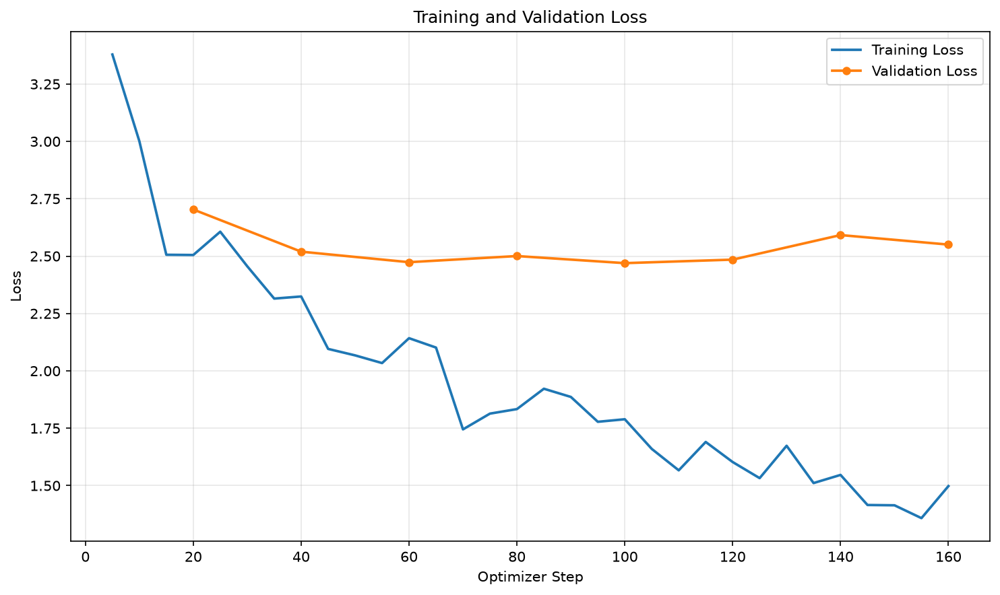

# 土味情話多輪對話專家

用 LoRA 微調小型語言模型，建立一個可以多輪對話的「土味情話」專家。

## 這個模型在做什麼

使用者丟出一個情境，模型用親切、溫和的台灣繁體中文接下一句土味情話。它會記得前面的對話，所以可以連續聊好幾輪。

system prompt：

```text
你是一個情話高手，你會以親切、溫和的口吻來回答使用者的問題。請用台灣繁體中文，順著上一句接土味情話，不要冒犯對方。
```

## 基礎模型

- [Qwen/Qwen2.5-0.5B-Instruct](https://huggingface.co/Qwen/Qwen2.5-0.5B-Instruct)

## 安裝套件

Python 3.12：

- torch (2.14.1)
- transformers (5.17.0)
- peft (0.21.0)
- trl (1.13.0)
- datasets (5.0.1)
- accelerate (1.15.0)
- matplotlib (3.11.2)

在 Colab 用 `train_qlora.py` 時還需要 `bitsandbytes`，版本見 `requirements-colab.txt`。

## 語料

語料寫在 `build_pickup_data.py` 的 `DIALOGUES`，一共 92 段多輪對話，每段至少 3 輪（「使用者問、專家答」算一輪）。情境包括搭訕、約會、傳訊息、安慰對方、被拒絕時怎麼得體回應等等。

`prepare_chat_data.py` 會把每一段多輪對話展開成好幾筆訓練資料，每一筆都帶著前面的對話紀錄，讓模型學會接續上下文：

| | 對話段數 | 訓練筆數 |
| --- | --- | --- |
| train | 83 | 251 |
| validation | 9 | 27 |

訓練語料範例：

```text
你：教我如何透過長相來認識女性朋友。
專家：你就跟她說「你長得很像我一個朋友」。
你：長得像你朋友？
專家：沒錯，跟她說「你長得像我下一任女朋友」。
```

## 執行方法

```bash
python build_pickup_data.py
python prepare_chat_data.py
python train_lora_mac.py      # Mac（Apple Silicon）
# python train_qlora.py       # Colab（NVIDIA GPU）
python plot_loss.py
python infer_lora_chat.py
```

- `train_qlora.py` 用 bitsandbytes 做 4-bit QLoRA，只能在 NVIDIA GPU 上跑。
- `train_lora_mac.py` 是給 Mac 用的版本：不做量化，用 float32 加上 LoRA。兩支程式的資料、LoRA 設定、輸出位置都相同，訓練好的 adapter 都能用同一支 `infer_lora_chat.py` 測試。
- 這份作業是用 `train_lora_mac.py` 在 Apple M4 上訓練的，大約 8 分鐘。

`infer_lora_chat.py` 是互動模式。輸入訊息後按 Enter，輸入 `/reset` 清除對話，輸入 `exit` 結束。

## 訓練設定

| 參數 | 值 |
| --- | --- |
| LoRA r / alpha / dropout | 8 / 16 / 0.05 |
| target modules | all-linear |
| 可訓練參數 | 4,399,104（0.88%） |
| epochs | 5 |
| batch size | 4（gradient accumulation 2） |
| learning rate | 1e-4 |
| loss | 只算 assistant 回答的部分（completion only） |
| 每 20 steps 驗證一次 | 依 `eval_loss` 保留 best model |

## 成果

### Loss

| step | epoch | eval_loss |
| --- | --- | --- |
| 20 | 0.63 | 2.7032 |
| 40 | 1.25 | 2.5195 |
| 60 | 1.89 | 2.4736 |
| 80 | 2.51 | 2.5004 |
| **100** | **3.13** | **2.4695** |
| 120 | 3.76 | 2.4848 |
| 140 | 4.38 | 2.5918 |
| 160 | 5.00 | 2.5503 |

step 100 的 validation loss 最低，`outputs/qwen25_05b_lora/` 存的是這個 checkpoint。training loss 一路降到 1.5 左右，但 validation loss 在 2.5 附近就不太動了：語料只有兩百多筆，模型學得會語氣，但很難把沒看過的句子背起來。



### 多輪對話實測

以下是 `infer_lora_chat.py` 的實際輸出（有開 sampling，每次執行的回答會不一樣）。

**對話 1：訓練語料裡出現過的情境**

```text
你：教我如何透過長相來認識女性朋友。
專家：你說「我的長相是妳第一次見我時所看到的」。
你：長得像你朋友？
專家：你答「不是，但我知道妳很喜歡」。
你：那如果她問「你上一任女朋友呢？」
專家：你就說「上一輩子的下一個都是妳」。
```

**對話 2：訓練語料裡沒有的情境**

```text
你：在便利商店排隊結帳時遇到她，可以說什麼？
專家：你說「妳看來是個有耐心的人，我先排到妳前面去」。
你：她說她只是來買便當。
專家：你答「那就好，我的便當也是一樣，等妳買完後，我也一起進一桌」。
你：她問你要買什麼？
專家：你答「沒關係，我想買一些可以幫忙排隊的人」。
```

### 觀察

- 模型學會了語料的格式：每次都用「你說／你答「……」」的方式回答，也會順著上一句接話。
- 對話 1 的「上一輩子的下一個都是妳」有土味情話的味道，但沒有完全照著語料回答，代表模型不是單純背答案。
- 對話 2 是沒看過的情境，句子就比較不通順，例如「我先排到妳前面去」其實有點失禮。0.5B 的模型能力有限，想要更好的效果，可以增加語料，或換成 1.5B 以上的模型。

## 檔案結構

```
outputs/qwen25_05b_lora/   LoRA adapter（best model，不含 checkpoint-*）與 loss_curve.png
data/chat.jsonl            build_pickup_data.py 產生的多輪對話
data/sft/                  prepare_chat_data.py 切好的 train / valid
build_pickup_data.py       土味情話語料
prepare_chat_data.py       把多輪對話展開成 SFT 訓練資料
train_lora_mac.py          Mac（MPS）LoRA 訓練
train_qlora.py             Colab（CUDA）QLoRA 訓練
plot_loss.py               畫 loss 曲線
infer_lora.py              單輪推論
infer_lora_chat.py         多輪互動對話
```
